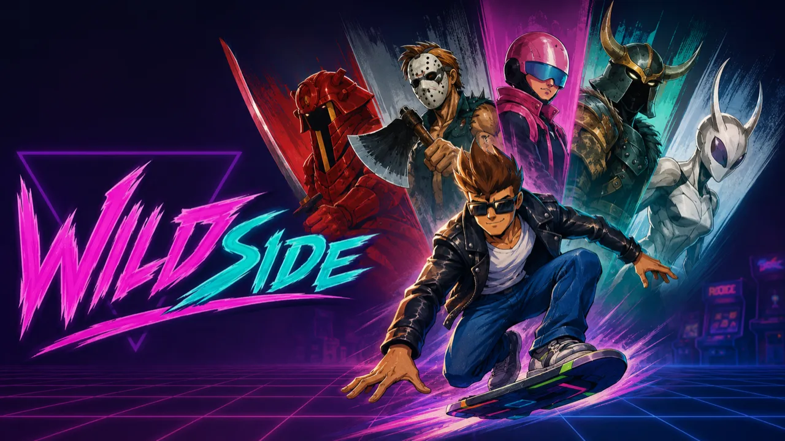

<p align="center">
  
</p>

<h1 align="center">Wildside</h1>

<p align="center"><em>A coding-agent experiment: SEGA's <strong>Kid Chameleon</strong> rebuilt in Rust and checked against a real emulator.</em></p>

---

Wildside asks a simple question: how far can you get by running coding agents in a
loop against a hard target that has an objective measure of correctness? The
target is *Kid Chameleon*, a Mega Drive platformer the author grew up on, rebuilt
natively in Rust from a user-supplied ROM. Every behaviour gets traced from the
public disassembly and checked frame by frame against a real emulator
(`jgenesis`) used as a ground-truth oracle. That last part matters: it means an
agent cannot mark its own homework. (The name comes from the in-fiction VR arcade
game in *Kid Chameleon*'s own story.)

The goal is a playable game. Bit-perfect parity is the bar the port is held to,
even though it will not get all the way there, and that is fine. Fidelity is the
method, not the destination: read the 68k disassembly, diff against the oracle,
reproduce the original bugs on purpose, then trade accuracy back toward something
that is fun to play.

For the longer story, why it exists and how the agent loop actually worked, see
[`docs/why.md`](docs/why.md).

> **Disclaimer.** Kid Chameleon is a trademark of SEGA Corporation. This is an
> independent, non-commercial reimplementation of the Kid Chameleon engine in
> Rust. No game code, ROM data, or copyrighted assets are distributed with this
> repository. You must own an original copy of the Kid Chameleon ROM to use this
> software. SEGA is not affiliated with this project and has not endorsed it.

## Platforms

| Platform | Status |
| --- | --- |
| Linux (x86-64 / arm64) | ✅ Supported |
| macOS | ✅ Supported |
| Windows | Untested |
| Web (WASM) | 🎮 Playable (preview) |

Desktop builds run on SDL2. Development and oracle setup (system SDL2 deps, asset
extraction, disassembly, emulator) is wired through `mise run bootstrap-*` and
`mise run oracle-setup`; skip it if you just want to play.

The web build runs via `mise run web-worker-dev`. It builds a host-neutral static
package in `web/dist` and serves it locally through Cloudflare Workers Static
Assets with the COOP/COEP headers required by the SharedArrayBuffer audio ring.
The default package contains no ROM or derived game bundle: the browser asks for a
user-owned canonical ROM, verifies it, and extracts the runtime assets locally in a
Web Worker. Remembering the ROM is opt-in and uses browser-private storage.

`web/config.json` selects picker, ROM URL, or prebuilt-bundle URL mode; examples
live under `web/configs/`. URL modes can fall back to the local picker. Audio starts
on first key/click because an `AudioContext` requires a user gesture. `?level=N`
warps straight into a level; the console exposes `window.wildside`,
`window.wildsideAudio`, and `window.wildsideAssetWorker` for probing. Local Worker
readiness is configured, but this repository does not create or deploy a remote
Cloudflare Worker.

## Quick start

Drop the ROM at `./roms/kid.bin`, `./kid.bin`, or `./kc.md`. Then:

```bash
mise trust .mise.toml         # trust the task runner
mise run bootstrap-native     # one-time native setup (assets + level grids)
mise run play-native          # play the native source-port runtime
mise run play                 # or: the emulator-backed shell with menus + audio
mise run project-status       # repo health: 1p-playable / 1p-accurate signals
mise run verify-slice-fast    # fast regression gate (run before committing)
```

That is the everyday surface. For anything else, `wildside --help` and `mise tasks`
list the rest — see the [command reference](docs/commands.md) for the pointer and
the canonical gates.

## Status

Current frontier: **1P whole-game fidelity hardening** on the native runtime.

- Headline signal: `wildside release-gate --target 1p-playable`
- Parity signal: `wildside release-gate --target 1p-accurate`

A green TAS or release artefact means `replay-matched` on those routes. It does
not mean the whole game is finished. `wildside project-status` keeps the two
signals apart so nobody reads a green gate as "nearly done".

## Where to go next

| You want to… | Read |
| --- | --- |
| Look up any command (`--help` pointer) and the canonical gates | [`docs/commands.md`](docs/commands.md) |
| Understand the crate layout and boundaries | [`docs/architecture.md`](docs/architecture.md) |
| Understand the source-port research method | [`CLAUDE.md`](CLAUDE.md) · [`docs/source-port/reference-index.md`](docs/source-port/reference-index.md) |
| Take a loop session / pick the next task | [`docs/source-port/loop.md`](docs/source-port/loop.md) · [`docs/source-port/backlog.md`](docs/source-port/backlog.md) |
| Trace Level 1 in detail | [`docs/source-port/level-1-dossier.md`](docs/source-port/level-1-dossier.md) |

## Licence

See [`LICENSE`](LICENSE). The vendored FM core under `third_party/ymfm`
(`aaronsgiles/ymfm`) is BSD-3-Clause; the `ymfm-sys` wrapper is MIT, so that
crate ships as `MIT AND BSD-3-Clause`.
